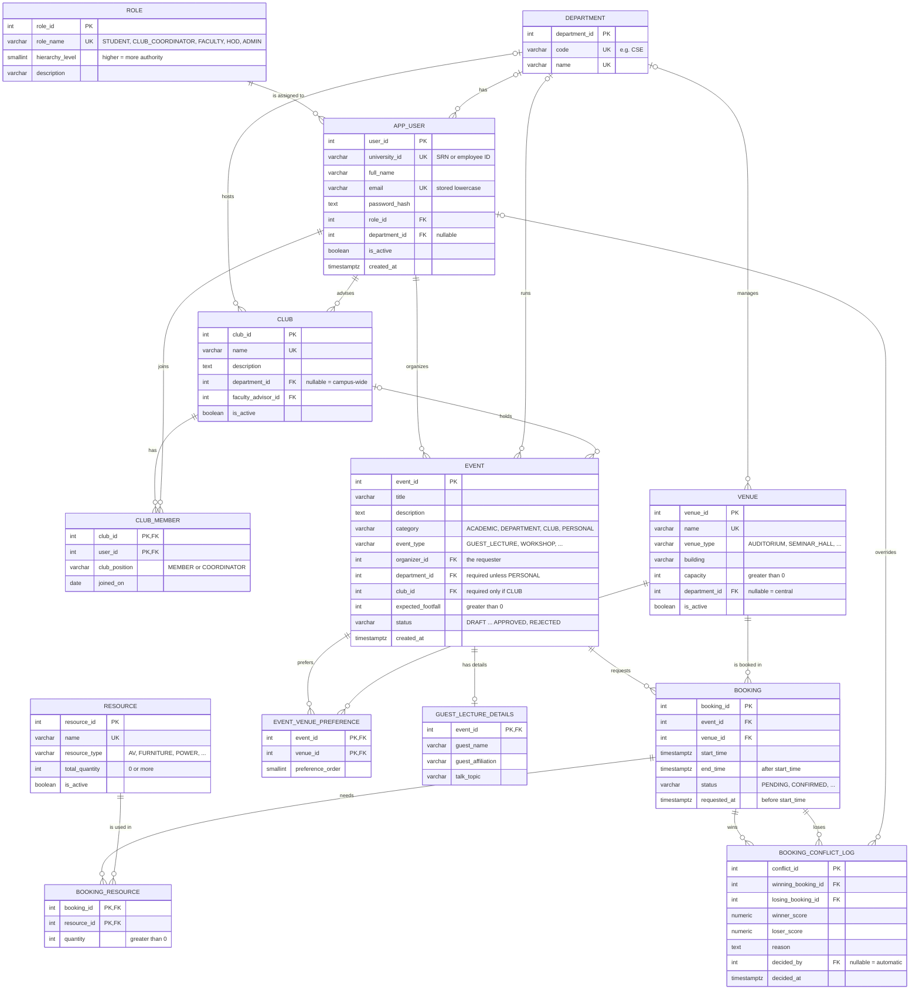

# CERMS: ER Diagram

This diagram covers the PostgreSQL side of CERMS: 13 tables, matching [db/sql/schema.sql](../db/sql/schema.sql).
The approval workflow lives in MongoDB and is described at the end of this page.

For a nicer image, paste [schema.dbml](schema.dbml) into <https://dbdiagram.io>.

## How to read it

| Symbol | Meaning |
|---|---|
| `PK` | primary key |
| `FK` | foreign key |
| `UK` | unique (candidate key) |
| `\|\|--o{` | exactly one ... zero or more |
| `\|o--o{` | zero or one ... zero or more (the FK column is nullable) |

## Relationships in words

| Relationship | Cardinality | Notes |
|---|---|---|
| Role to User | 1 : N | every user has exactly one role |
| Department to User | 1 : N, optional | central admin staff have no department |
| Department to Club | 1 : N, optional | NULL department = campus-wide club |
| User (faculty) to Club | 1 : N | each club has exactly one faculty advisor |
| User to Club | **M : N** | resolved by the bridge table `CLUB_MEMBER` |
| Department to Venue | 1 : N, optional | which department manages the venue |
| User to Event | 1 : N | the organizer (requester) of the event |
| Department / Club to Event | 1 : N, optional | rules depend on category (see below) |
| Event to Booking | 1 : N | one event can book several slots or venues |
| Venue to Booking | 1 : N | |
| Booking to Resource | **M : N** | resolved by the bridge table `BOOKING_RESOURCE`, which also holds the quantity |
| Booking to Conflict Log | 1 : N, twice | a booking can appear as the winner or the loser of a decision |
| User (admin) to Conflict Log | 1 : N, optional | set only when an admin overrides the automatic decision |

Rules that the diagram cannot show (they are CHECK constraints in the DDL):

- A `CLUB` event must have a `club_id`; other categories must not.
- Every event except `PERSONAL` must have a `department_id`.
- Venue preferences are ranked uniquely per event; the booking stores the assigned venue.
- Guest lecture events may have a separate details row for visitor and talk information.
- Two `CONFIRMED` bookings of the same venue cannot overlap in time (exclusion constraint).

## MongoDB side (not in the ER diagram)

| Collection | One document is ... | Link to PostgreSQL |
|---|---|---|
| `workflow_templates` | an approval chain (ordered list of stages) for an event category, type or department | stages name roles from the `role` table |
| `workflow_instances` | the live approval of one event, with the status of each stage | `event_id` refers to `event.event_id`; user IDs refer to `app_user.user_id` |

These links are logical, not enforced: MongoDB cannot hold a foreign key into PostgreSQL. The application checks them.
Sample documents: [db/mongo/](../db/mongo/).
